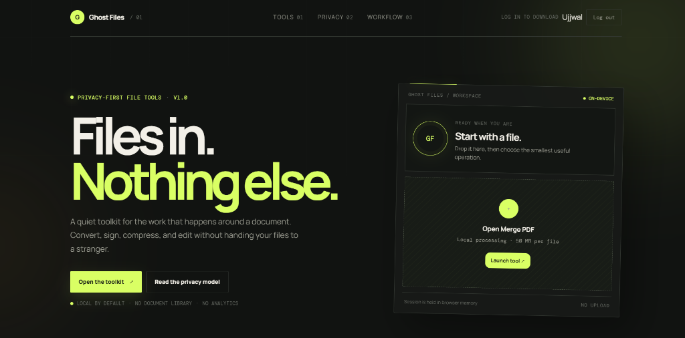
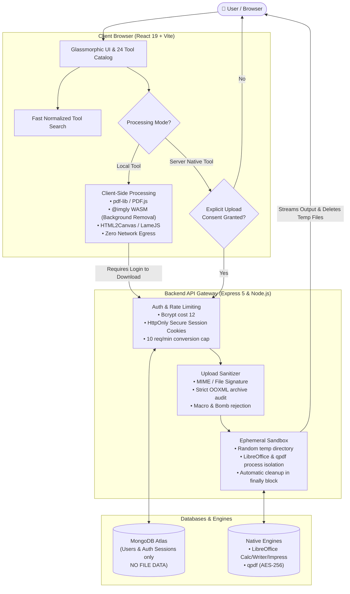

# <p align="center">👻 Ghost Files</p>

<p align="center">
  <strong>A high-performance, privacy-first file conversion and manipulation toolkit.</strong><br>
  <em>Convert, edit, compress, and transform documents locally in your browser — zero telemetry, zero database file retention, with sandboxed server-side native engines when you need them.</em>
</p>

<p align="center">
  <a href="https://ghost-files-client-0fz5.onrender.com"></a>
  <a href="https://drive.google.com/file/d/1z_4U09hSHlRNM3Skvx7uzsajou_XViHS/view?usp=sharing"></a>
  <a href="#-tools-and-capabilities"></a>
  <a href="LICENSE"></a>
</p>

<p align="center">
  
  
  
  
  
  
  
  
</p>

<p align="center">
  <a href="https://ghost-files-client-0fz5.onrender.com" target="_blank" rel="noopener noreferrer">
    
  </a>
</p>

---

## 🎬 Demonstration & Video Walkthrough

> ### 🎥 [Watch the Full Ghost Files Video Demonstration on Google Drive](https://drive.google.com/file/d/1z_4U09hSHlRNM3Skvx7uzsajou_XViHS/view?usp=sharing)
>
> 🍿 **In this walkthrough, you'll see:**
>
> - **Client-side instant processing**: In-browser PDF merging, page reordering, splitting, and local client rendering with zero server uploads.
> - **AI-powered background removal**: Local neural inference executing inside the browser via WebAssembly without remote image leaks.
> - **Sandboxed server conversions**: Converting native Office documents (Word, Excel, PowerPoint) to PDF with explicit user consent and ephemeral container isolation.
> - **Secure authentication & download gate**: Bcrypt-backed signup/login, HttpOnly session handling, and guest download protection.

<p align="center">
  <a href="https://drive.google.com/file/d/1z_4U09hSHlRNM3Skvx7uzsajou_XViHS/view?usp=sharing">
    
  </a>
</p>

---

## 📌 Table of Contents

- [🎬 Demonstration & Video Walkthrough](#-demonstration--video-walkthrough)
- [✨ Key Highlights](#-key-highlights)
- [🏗️ System Architecture](#️-system-architecture)
- [🛠️ Tools and Capabilities](#️-tools-and-capabilities)
  - [📑 PDF Manipulation & Editing](#-pdf-manipulation--editing)
  - [📄 Office & Document Conversion](#-office--document-conversion)
  - [🖼️ Image Processing & Local AI](#️-image-processing--local-ai)
  - [🔒 Security & Audio Utilities](#-security--audio-utilities)
- [🚀 Quick Start & Deployment](#-quick-start--deployment)
  - [🐳 Option 1: Docker Preview (Zero Setup)](#-option-1-docker-preview-zero-setup)
  - [💻 Option 2: Local Development](#-option-2-local-development)
  - [☁️ Option 3: Render Production Deployment](#️-option-3-render-production-deployment)
- [🔐 Accounts & Authentication](#-accounts--authentication)
- [⚙️ Configuration Reference](#️-configuration-reference)
- [🛡️ Privacy, Security & Sandbox Hardening](#️-privacy-security--sandbox-hardening)
- [🧪 Verification & Testing](#-verification--testing)
- [🔧 Troubleshooting](#-troubleshooting)
- [📁 Project Structure](#-project-structure)
- [📄 License](#-license)

---

## ✨ Key Highlights

- **⚡ 100% Client-Side Processing Where Feasible**: Most PDF, image, and audio manipulations take place in browser memory via Web Workers, WebAssembly, and JavaScript engines (`pdf-lib`, `PDF.js`, `@imgly/background-removal`, `lamejs`).
- **🛡️ Strict Zero-Retention Guarantee**: Files are **never stored** in MongoDB or retained on permanent disk. Server-side jobs run in isolated temporary scratch directories that are deleted immediately upon completion or cancellation.
- **🖥️ Sandboxed Native Engine**: Enterprise conversions (DOCX, PPTX, XLSX to PDF, and AES-256 PDF encryption/decryption) utilize LibreOffice and `qpdf` in an egress-blocked, non-root Docker container.
- **🔐 Hardened Authentication & Sessions**: Real user signup/login backed by MongoDB, bcrypt (cost 12), SHA-256 hashed session identifiers with automatic TTL pruning, and strict `HttpOnly` `SameSite=Strict` host-only cookies.
- **🎨 Modern Glassmorphic Interface**: Responsive layout with dynamic theme accents, live search with instant keyboard navigation (Escape-to-clear), batch queue, individual & ZIP exports, and reduced-motion support.

---

## 🏗️ System Architecture

Ghost Files balances privacy and computing power by segregating local browser operations from sandboxed server jobs:



---

## 🛠️ Tools and Capabilities

All 24 tools feature independent, shareable routes under `/tools/...` with full deep-linking, refresh support, and browser history integration.

### 📑 PDF Manipulation & Editing

| Tool              |    Mode     | Capabilities & Limits                                                                                                        |
| :---------------- | :---------: | :--------------------------------------------------------------------------------------------------------------------------- |
| **Merge PDF**     | `⚡ Client` | Combines multiple PDFs into a single file in custom sequence; accessible file reordering.                                    |
| **Split PDF**     | `⚡ Client` | Extracts custom page ranges (e.g., `1-3, 5` or `all`); outputs individual files or a consolidated ZIP.                       |
| **Compress PDF**  | `⚡ Client` | Re-renders pages with selectable quality/resolution parameters; displays real-time before/after byte comparisons.            |
| **Edit PDF**      | `⚡ Client` | Overlays custom text, transparent PNG images, and geometric annotations with pinpoint coordinate positioning.                |
| **Organize PDF**  | `⚡ Client` | Visual page grid: lazy-rendered thumbnails, drag-and-drop reordering, 90° rotations, selective deletion, and instant export. |
| **Rotate PDF**    | `⚡ Client` | Incremental 90°, 180°, or 270° clockwise page rotations for individual pages or entire documents.                            |
| **Sign PDF**      | `⚡ Client` | Freehand drawing pad, typed signatures, or PNG stamp placement on chosen pages (visual stamp; non-PKI).                      |
| **Watermark PDF** | `⚡ Client` | Stamped text or high-resolution PNG watermarks with configurable opacity, angles, page scopes, and offsets.                  |

---

### 📄 Office & Document Conversion

| Tool                  |    Mode     | Capabilities & Limits                                                                                            |
| :-------------------- | :---------: | :--------------------------------------------------------------------------------------------------------------- |
| **Word to PDF**       | `🖥️ Server` | High-fidelity `.docx` conversion via LibreOffice Writer. Enforces strict OOXML signature and macro verification. |
| **PowerPoint to PDF** | `🖥️ Server` | Converts `.pptx` presentations. Pre-processes and downsamples embedded images > 4096px to prevent memory spikes. |
| **Excel to PDF**      | `🖥️ Server` | Formatted spreadsheet conversion of validated `.xlsx` workbooks via LibreOffice Calc.                            |
| **PDF to Word**       | `⚡ Client` | Parses selectable PDF text and structural blocks into editable native DOCX paragraphs. _(No OCR for scans)_      |
| **PDF to PowerPoint** | `⚡ Client` | Translates selectable PDF pages into individual editable slide text boxes.                                       |
| **PDF to Excel**      | `⚡ Client` | Parses aligned tabular text coordinates from PDF pages into multi-column XLSX sheets.                            |
| **HTML to PDF**       | `⚡ Client` | Sanitizes user-entered HTML markup with DOMPurify and renders to a downloadable multi-page PDF document.         |

---

### 🖼️ Image Processing & Local AI

| Tool                   |    Mode     | Capabilities & Limits                                                                                                                |
| :--------------------- | :---------: | :----------------------------------------------------------------------------------------------------------------------------------- |
| **Background Remover** | `⚡ Client` | In-browser neural segmentation using `@imgly/background-removal` WASM. Export transparent PNGs or composite with custom backgrounds. |
| **Image Converter**    | `⚡ Client` | High-throughput batch conversion between PNG, JPEG, and WebP formats.                                                                |
| **Image Resizer**      | `⚡ Client` | Pixel dimension scaling, percentage scaling, and aspect-ratio preservation.                                                          |
| **Image Compressor**   | `⚡ Client` | Lossy and lossless image re-encoding with real-time file-size savings analytics.                                                     |
| **PDF to JPG**         | `⚡ Client` | Extracts document pages as raster images (JPEG/PNG) at user-selected DPI scales with ZIP bundling.                                   |
| **JPG to PDF**         | `⚡ Client` | Converts collections of JPEG, PNG, and WebP files into a structured PDF with custom margins and orientations.                        |

---

### 🔒 Security & Audio Utilities

| Tool               |    Mode     | Capabilities & Limits                                                                                                        |
| :----------------- | :---------: | :--------------------------------------------------------------------------------------------------------------------------- |
| **Protect PDF**    | `🖥️ Server` | Encrypts PDF documents with user passwords using `qpdf` standard AES-256 encryption.                                         |
| **Unlock PDF**     | `🖥️ Server` | Strips encryption from password-protected PDFs using the legitimate owner password.                                          |
| **Video to Audio** | `⚡ Client` | Direct in-browser extraction of audio streams from video containers (`.mp4`, `.webm`, `.mov`, `.mkv`) into MP3, WAV, or AAC. |

> [!NOTE]
> **Operational Limits**: Local PDFs are capped at 300 pages and 50 MB each. Server uploads are capped at 25 MB per file. Image rendering canvases are limited to 24 megapixels. Batch sessions support up to 20 files / 150 MB total input.

---

## 🚀 Quick Start & Deployment

### 🐳 Option 1: Docker Preview (Zero Setup)

Experience Ghost Files immediately with the full native conversion engine pre-installed:

```bash
# Clone the repository
git clone https://github.com/pentest200/GhostFiles.git
cd GhostFiles

# Spin up the containers
docker compose up --build -d --wait
```

Open your browser at **http://localhost:4180**.

- The API is automatically proxied through `/api` on the same origin.
- LibreOffice (Writer/Calc/Impress) and `qpdf` are bundled and ready.
- _Note:_ The preview configuration runs without MongoDB enabled. To test accounts and downloads, follow the local development setup below.

---

### 💻 Option 2: Local Development

#### Prerequisites

- **Node.js**: v22.15.0 or higher
- **npm**: v10+ (On Windows PowerShell, use `npm.cmd` if script execution policies block `.ps1`)
- **Optional Native Tools**: LibreOffice and `qpdf` on your system `PATH` (or configured via `.env`).

```powershell
# 1. Initialize environment configuration
if (!(Test-Path .env)) { Copy-Item .env.example .env }

# 2. Install workspace dependencies
npm.cmd ci

# 3. Start development servers concurrently (Client on :5173, Server on :8787)
npm.cmd run dev
```

- **Frontend Client**: [http://localhost:5173](http://localhost:5173) (Proxies `/api` calls to server)
- **Backend API Health Check**: [http://localhost:8787/health](http://localhost:8787/health)

---

### ☁️ Option 3: Render Production Deployment

The repository includes a ready-to-deploy [`render.yaml`](render.yaml) blueprint declaring both the Client (Nginx static + reverse proxy) and the API (Dockerized Node + LibreOffice + qpdf):

1. Link the repository to your Render account as a **Blueprint**.
2. Set the private environment variables for the API:
   - `MONGODB_URI`: Your MongoDB Atlas connection string.
   - `AUTH_JWT_SECRET`: A generated 48-byte cryptographically secure hex secret.
   - `CLIENT_ORIGIN`: Your public HTTPS frontend URL (e.g. `https://ghost-files-client-0fz5.onrender.com`).
3. Set the Client `API_BASE_URL` to point to the API service.
4. Deploy and verify `/api/auth/status` and `/health`.

---

## 🔐 Accounts & Authentication

Ghost Files provides real, secure authentication for user workflows while upholding the principle that **no documents are stored in the database**:

```
┌─────────────────────────────────────────────────────────────┐
│                       Stored in MongoDB                     │
├────────────────────────────────┬────────────────────────────┤
│ users Collection               │ authsessions Collection    │
├────────────────────────────────┼────────────────────────────┤
│ • Normalized Email (Indexed)   │ • SHA-256 Hashed Token ID  │
│ • User Display Name            │ • User Reference ObjectId  │
│ • Bcrypt Cost-12 Password Hash │ • Expiration (TTL Index)   │
│ • Timestamps                   │ • Revocation Tracking      │
└────────────────────────────────┴────────────────────────────┘
         ⚠️ ZERO FILE DATA OR METADATA IS STORED
```

### Security Details

- **Password Policy**: Minimum 15 characters, maximum 72 UTF-8 bytes (preventing bcrypt truncation attacks).
- **Cookie Architecture**: Signed 8-hour JWT sessions stored in host-only cookies:
  - _Production_: `__Host-ghost_session`, `Secure`, `HttpOnly`, `SameSite=Strict`, `Path=/`.
  - _Development_: `ghost_session`, `HttpOnly`, `SameSite=Strict`.
  - _Zero token storage in `localStorage` or `sessionStorage`_.
- **Revocation**: Logging out instantly drops the session in MongoDB, preventing replay of valid JWTs.

---

## ⚙️ Configuration Reference

Configure settings in the root `.env` file (copied from [`.env.example`](.env.example)):

| Variable              |      Default Value      | Description                                                     |
| :-------------------- | :---------------------: | :-------------------------------------------------------------- |
| `NODE_ENV`            |      `development`      | Environment mode (`development` or `production`).               |
| `CLIENT_ORIGIN`       | `http://localhost:5173` | Allowed client origin for CORS and session cookies.             |
| `AUTH_ENABLED`        |         `true`          | Enables authentication and user management endpoints.           |
| `AUTH_JWT_SECRET`     |    _(Random String)_    | Secret key (>= 32 chars) for signing HS256 tokens.              |
| `MONGODB_ENABLED`     |         `true`          | Enables database connectivity for accounts.                     |
| `MONGODB_URI`         |     `mongodb://...`     | MongoDB connection URI (local instance or Atlas).               |
| `MONGODB_DNS_SERVERS` |    `1.1.1.1,8.8.8.8`    | _(Optional)_ Explicit DNS resolvers for Atlas SRV lookups.      |
| `LIBREOFFICE_ENABLED` |         `true`          | Enables native Word/Excel/PowerPoint conversions.               |
| `LIBREOFFICE_PATH`    |    _(Auto-detected)_    | Path to LibreOffice executable (`soffice`).                     |
| `QPDF_PATH`           |    _(Auto-detected)_    | Path to `qpdf` executable for encryption/decryption.            |
| `MAX_UPLOAD_BYTES`    |   `26214400` (25 MB)    | Maximum accepted upload size for server conversions.            |
| `JOB_TIMEOUT_MS`      |    `120000` (2 mins)    | Hard timeout before native conversion processes are terminated. |
| `JOB_TTL_MS`          |   `900000` (15 mins)    | Lifetime of abandoned scratch directories before auto-sweep.    |

---

## 🛡️ Privacy, Security & Sandbox Hardening

Ghost Files implements defense-in-depth across the entire stack:

1. **Client-Side Privacy**: Local tools execute completely in client memory. No analytics, tracking pixels, or background document telemetry exist in the application.
2. **Explicit Consent Gate**: Server conversions mandate an active, explicit consent checkbox from the user before multipart payload parsing begins.
3. **Malicious File Neutralization**:
   - Uploads undergo MIME, extension, magic byte, and OOXML structure validation.
   - Office documents containing VBA macros, external XML relationships, executable payloads, or zip-bomb nesting are immediately rejected.
   - Large PPTX presentations have raster images > 4096px downsampled in a dedicated sub-process to eliminate memory-exhaustion exploits.
4. **Sandboxed Subprocess Execution**:
   - Subprocesses are spawned without shell interpolation (`execFile`).
   - Passwords for `qpdf` are passed via restricted file handles to prevent leakage in `ps` process lists.
   - Temporary job directories are created with randomized names under strict OS permissions and destroyed in `finally` blocks.
5. **Container Hardening**:
   - The production Docker container executes as a non-privileged user with a read-only root filesystem, dropped Linux capabilities, and an egress-blocked internal network.

---

## 🧪 Verification & Testing

Ghost Files features a comprehensive automated test suite covering unit logic, server pipelines, and end-to-end browser workflows:

```powershell
# Run backend and frontend unit tests
npm.cmd test

# Run full end-to-end browser suite (Playwright with headless Chrome)
npm.cmd run test:e2e

# Run security dependency audit
npm.cmd audit
```

### Running Auth Tests with Disposable MongoDB

To test the full signup, login, session revocation, and authenticated download flow locally:

```powershell
# Launch temporary ephemeral MongoDB container
docker run -d --rm --name ghostfiles-auth-tests -p 127.0.0.1:27028:27017 --tmpfs /data/db mongo:8.0.32 --bind_ip_all
$env:TEST_AUTH_MONGODB_URI='mongodb://127.0.0.1:27028'

try {
  npm.cmd test
  npm.cmd run test:e2e
} finally {
  Remove-Item Env:TEST_AUTH_MONGODB_URI
  docker stop ghostfiles-auth-tests
}
```

---

## 🔧 Troubleshooting

<details>
<summary><strong>🔍 Engine is unavailable in native conversion tools</strong></summary>

Ensure LibreOffice and `qpdf` are installed and reachable on your system `PATH`. Alternatively, set `LIBREOFFICE_PATH` and `QPDF_PATH` explicitly in `.env`. If running via Docker, verify the containers are healthy with `docker compose ps`.
</details>

<details>
<summary><strong>⌨️ Search bar appears stuck or missing cards</strong></summary>

Clear the search input using the ✕ button or press the <kbd>Escape</kbd> key. All 24 tools will immediately reappear. If an older tab is open in production, perform a hard refresh (`Ctrl + F5`) to invalidate the cached bundle.
</details>

<details>
<summary><strong>🚫 HTTP 403 on Login / Signup</strong></summary>

Verify that `CLIENT_ORIGIN` in `.env` matches the exact protocol, domain, and port of your browser (e.g., `http://localhost:5173`). Restart the API server after any `.env` changes.
</details>

<details>
<summary><strong>🌐 MongoDB Atlas SRV DNS Resolution Failures</strong></summary>

Some local networks or ISP routers fail to resolve Atlas SRV DNS records. Add `MONGODB_DNS_SERVERS=1.1.1.1,8.8.8.8` to your root `.env` to route DNS lookups directly through Cloudflare and Google public resolvers.
</details>

<details>
<summary><strong>⏱️ HTTP 502 / 504 on Server Conversions</strong></summary>

The gateway or conversion process timed out. Ghost Files handles one native conversion at a time with a 2-minute deadline. For massive presentations, reduce slide image sizes or retry after competing conversions finish.
</details>

<details>
<summary><strong>📄 Legacy Office Formats (.doc, .ppt, .xls) Rejected</strong></summary>

Only modern OOXML formats (`.docx`, `.pptx`, `.xlsx`) are supported for security and parsing integrity. Save legacy documents in modern Office formats before converting.
</details>

---

## 📁 Project Structure

```
GhostFiles/
├── client/                     # Frontend Application (React 19 + Vite)
│   ├── src/
│   │   ├── components/         # Modals, Tool Cards, Workspaces, Nav
│   │   ├── lib/                # Client processors (PDF, Canvas, Img, Auth)
│   │   │   └── catalog.js      # Definitive catalogue of all 24 tools
│   │   ├── App.jsx             # Main router and state coordinator
│   │   └── styles.css          # Core design system and glassmorphic styles
│   └── Dockerfile              # Production multi-stage Nginx container
│
├── server/                     # Backend API (Express 5 + Node.js 22)
│   ├── src/
│   │   ├── models/             # User and AuthSession schemas (Mongoose)
│   │   ├── routes/             # /auth, /convert, /capabilities, /health
│   │   └── conversion.js       # Native engine runners, sandbox & sweeps
│   └── Dockerfile              # Hardened API container with LibreOffice & qpdf
│
├── docs/                       # Architectural & Security Documentation
│   ├── authentication.md       # Deep-dive into session cookies and crypto
│   ├── security-review.md      # Dependency audits & CVE mitigation notes
│   └── browser-warning-remediation.md
│
├── tests/                      # Integration and Playwright E2E suites
├── docker-compose.yml          # Zero-config engine preview stack
└── render.yaml                 # Infrastructure-as-code deployment blueprint
```

---

## 📄 License

This project is licensed under the [MIT License](LICENSE) © 2026 Ujjwal Shreshtha.

<p align="center">
  <sub>Built with ❤️ for privacy, performance, and user ownership of data.</sub>
</p>
